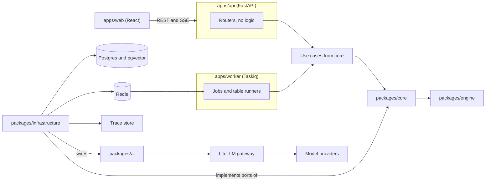
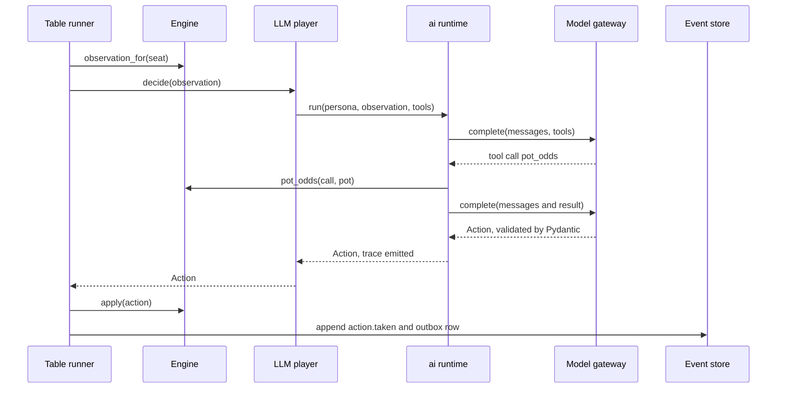

# Range architecture

Range teaches a beginner to think about poker from first principles, and it doubles as a platform for learning how serious agent systems are built. The two goals pull in the same direction, because a coach worth trusting needs deterministic tools, durable memory and measurable behavior, which are exactly the pieces an agent platform has to get right.

This document records the decisions made so far, the structure that follows from them, the risks found in review, and the order of work. Items marked as calls are defaults chosen to keep moving, and each one can be vetoed without disturbing the rest.

## Principles

1. **One poker engine, in Python.** The web app does no poker math, so no rule or formula ever exists twice.
2. **The model never does arithmetic.** Odds, equity and expected value come from engine tools, and the coach cites their output, which is what makes its advice checkable.
3. **Domain events and agent traces are different things.** Domain events are durable facts with stable schemas. Traces are high volume, short lived and may contain personal data, so they live in a separate store and link back by id.
4. **Each agent sees only its own view.** The engine builds that view and the storage layer enforces it, because a prompt is a request while a projection is a guarantee.
5. **Ports belong to their consumer.** The domain defines the interfaces it needs, and outer layers implement them, so the domain never learns that LLMs, Postgres or Redis exist.
6. **Contracts have one source.** Pydantic models generate the OpenAPI schema, which generates the TypeScript client, and CI fails when they drift.
7. **Feedback stays fast.** Lint, types and boundary checks finish in seconds on both languages, because slow checks get skipped.

## Quality attributes

The ranking below decides trade-offs when two goals conflict, and each attribute has an automated check so it cannot erode silently.

| Rank | Attribute | Fitness function |
| --- | --- | --- |
| 1 | Advice correctness | Eval suite scores coach claims against engine results, and engine golden and property tests stay green |
| 2 | Hidden information integrity | A test proves a seat reader can never return another seat's hole cards, and memories inherit source visibility |
| 3 | Cost | A ceiling on cost per hand and per run, with a kill switch |
| 4 | Latency | A p95 budget for an LLM seat's turn, with a timeout that falls back to bot policy |
| 5 | Evolvability | Import boundaries, API contract drift and event schema upcaster tests all pass in CI |

## Decisions

### Made with the project owner

| Topic | Choice | Reason |
| --- | --- | --- |
| Name | Range | Also the poker term for the set of hands a player could hold, which is the idea the coach ends up teaching. |
| Poker math | Python only, wrapped behind engine-owned types around a maintained library | One source of truth across languages. Candidates are PokerKit for rules and hand evaluation and eval7 for fast equity, and a spike picks between them. |
| Agent runtime | Built from scratch on Pydantic and LiteLLM | The owner wants to see and own every layer, and a platform that outgrows a prototype needs its own runtime instead of a hidden one. |
| Players | Hybrid pool, rule bots for volume and a few budgeted LLM players | Bots are free and replayable, while LLM players add reasoning traces and surprise at a capped cost. |
| Data layer | Postgres with pgvector, plus Redis | Postgres holds events, history and memories, and Redis carries live streams and the job queue. |
| Packages | Few and coarse, with boundaries enforced as folders | Ten packages is ceremony. A package exists only when something must ship, version or be owned separately. |

### Calls made to keep moving

| Call | Reason | Cost to reverse |
| --- | --- | --- |
| pnpm workspace for TypeScript, uv workspace for Python, `just` at the root | Each language keeps its native tool and one command fans out across both. | Low |
| Python 3.13 managed by uv | System Python is 3.9 and PokerKit needs 3.11 or newer. | Low |
| FastAPI, SQLAlchemy 2, Alembic, psycopg 3 | Mainstream, typed, and async end to end. | Medium |
| A Postgres schema per context | Gives each context its own tables and migration branch, which limits Alembic head conflicts between parallel lanes. | Medium |
| Server-sent events for live streams | One-way streams are all the table and coach need, and SSE works over plain HTTP. | Low |
| Taskiq on Redis for background jobs | Async native, so it composes with the rest of the stack. | Low |
| OpenTelemetry for traces | A vendor-neutral standard that LiteLLM and FastAPI already emit. | Low |
| ruff, ty, import-linter, pytest, hypothesis | Fast and Rust-based where possible. `ty` is still 0.0.x, so pyright is the fallback if false positives block work. | Low |
| Model tiers by role through LiteLLM aliases | Model ids live in configuration, never in code. | Low |
| The worker is its own app, `apps/worker` | It deploys and scales separately from the API, and heavy simulations must not starve request handling. | Low |
| `evals` lives in `ai/evals` | Scenario sets and scorers need the engine and core types, and they exercise agents. | Low |

## System context



## Monorepo layout

```
range/
  apps/
    web/              React, Vite, TypeScript 7
    landing/          Astro static site, imports only the design system
    api/              FastAPI routers, API schemas, composition root
    worker/           Taskiq jobs, table runners, composition root
  packages/
    engine/           everything poker needs, pure
    core/             product entities, use cases and ports, one folder per context
    infrastructure/   database, event store, outbox, redis, telemetry, port adapters
    ai/
      runtime/        gateway, loop, tools, context, budget, tracing
      agents/         coach, analysts, LLM players
      evals/          scenario sets and scorers
    api-client/       generated TypeScript client, never edited by hand
    ui/               design system as @range/ui, with tokens, primitives and poker components
  infra/              docker compose for Postgres and Redis
  docs/               architecture, decision records, learning map
  justfile            polyglot task entry points
```

Dependencies run `apps` to `infrastructure` to `core` to `engine`. `infrastructure` also imports `ai` in order to wire agents to the ports `core` defines. `ai/agents` and `ai/evals` may import `core` and `engine`, while `ai/runtime` imports nothing of ours, so the runtime can be read, tested and reused as a general agent platform.

Rules, enforced by import-linter in CI.

- `engine` imports no other Range package and no web, database or vendor library beyond the one poker library it wraps.
- `core` imports `engine` only. It never imports `ai`, `infrastructure` or `apps`.
- The context folders inside `core` are independent of each other. They share engine types and a small shared folder holding the event envelope and ids.
- `infrastructure` implements the ports defined in `core` and owns every SQLAlchemy model, repository and client.
- `ai/runtime` imports nothing of ours.
- Routers validate input, call one use case and return its result. Each app wires its own dependencies in a small composition root that calls shared wiring helpers in `infrastructure`.

## Engine

`packages/engine` holds everything poker needs and nothing else. Given a seed and a sequence of actions it produces the same game every time, which is the property that makes replay, testing and fair comparison between agents possible.

| Area | Contents |
| --- | --- |
| Cards | Card, rank, suit, deck, seeded shuffle |
| Evaluation | Best five of seven, comparison with kickers, the A-2-3-4-5 straight |
| Game | No-limit hold'em state machine, betting rounds, side pots, showdown |
| Range | A weighted set of hand combos, combo and blocker counting, parsing and formatting |
| Equity | Exact enumeration on the turn and river, Monte Carlo earlier, equity against a hand and against a range |
| Odds and EV | Outs, pot odds, required equity, expected value of a call, bet or fold |
| Observation | `observation_for(seat)`, the only way any agent receives game state |
| Policies | Rule bots as pure functions from observation to action, with different styles |
| Scenarios | Generators and solutions for drills such as pot odds and outs, graded elsewhere |

The `Range` type exists because equity against a random hand teaches beginners to overcall, and the engine cannot verify range-dependent advice without it. It is also the central idea of the product.

The chosen library is wrapped behind engine-owned types so it can be replaced. Correctness is tested three ways, with golden vectors for known hands, property tests with hypothesis for invariants such as chip conservation, and cross-checks of the equity code against exhaustive enumeration on small boards. Equity is CPU bound, so callers run it in a process pool and cache results by canonical state.

## Core

`packages/core` holds the product's own concepts and never touches I/O. Each context has a `domain` folder for entities and rules and an `application` folder for use cases and the ports they need.

| Context | Holds |
| --- | --- |
| `play` | Tables, seats, hand lifecycle, the `PlayerPolicy` port |
| `coaching` | Advice, post-hand review, the `Coach` and `Analyst` ports |
| `learning` | Lessons, drills and grading, learner profile, preferences |
| `memory` | Memory entities, proposals, consolidation rules, the `MemoryStore` port |
| `history` | Hand records, search and statistics ports |

An entity belongs in the engine if it makes sense without a database or a user, and in `core` if it concerns the learner, memory, coaching or history. API request and response models do not live here. They live in `apps/api`, so the public contract can change without touching entities.

## Infrastructure

`packages/infrastructure` is the only place that knows about Postgres, Redis and vendors.

- **Database.** Each context gets its own Postgres schema, its own tables and its own Alembic branch. Repositories map ORM models to core entities explicitly, so entities stay free of persistence concerns. A unit of work wraps each use case in one transaction.
- **Event store.** Appends carry the expected `seq`, and a unique constraint on `(stream_id, seq)` makes concurrent writers fail loudly instead of corrupting a stream.
- **Outbox.** Every append also writes an outbox row in the same transaction. A relay publishes outbox rows to Redis, which removes the dual write where a commit succeeds and the publish fails.
- **Scoped readers.** `PublicEventReader`, `SeatEventReader` and `ReviewEventReader` are separate types, and each returns only what its viewer may see. Visibility is enforced here, never in routers.
- **Wiring.** Adapters implement the `Coach`, `PlayerPolicy` and `MemoryStore` ports by composing `ai/agents` with the runtime and gateway.
- **Telemetry.** OpenTelemetry exporters and the trace store.

## Domain events and traces

Domain events go in the Postgres event store and are kept permanently.

| Field | Purpose |
| --- | --- |
| `id`, `stream_id`, `seq` | Identity and strict ordering within one table, session or learner stream |
| `type`, `schema_version` | Discriminator for the typed payload and room to evolve it with upcasters |
| `occurred_at`, `actor` | When it happened and who caused it, whether user, bot, agent or system |
| `learner_id` | Present on every row now, because adding ownership later is expensive |
| `visibility` | Who may read it, `public`, `seat`, `review` or `system` |
| `trace_id` | Link to the agent run that produced it, when there was one |
| `payload` | Pydantic model serialized as JSON |

The families are table and hand lifecycle, `observation.issued`, `action.taken`, `advice.given`, `memory.committed` and `lesson.answered`.

Traces cover agent runs, model calls, tool calls, tokens, cost and latency, and they go to the trace store through OpenTelemetry. Prompts and tool payloads are stored by reference rather than inline, retention is time limited, and sampling is configurable. A replay of a hand re-applies recorded events, so it is exact. Re-running LLM agents is not reproducible, and the architecture does not pretend otherwise.

Live views reconnect with `Last-Event-ID` set to the stream `seq`. The API replays missed events from Postgres filtered by the viewer's visibility, then tails Redis. Redis pub/sub alone would drop events on every reconnect.

One agent turn looks like this.



## Agent platform

`ai/runtime` is where the learning goal lives. It is a small, readable runtime with these parts.

| Part | Responsibility |
| --- | --- |
| `ModelGateway` port | One method to run a completion with messages, tools and a response schema. The default adapter uses LiteLLM, a native Anthropic adapter is the escape hatch, and each model carries capability flags. |
| `AgentRuntime` | The loop that builds context, calls the model, validates output, runs tools, and stops on a final answer, a budget or a step limit. |
| `ContextBuilder` | Assembles the prompt in layers ordered for cache stability, with the volatile layers last. |
| `ToolRegistry` | Typed tools defined with Pydantic input and output models, tagged read-only or mutating, with scopes, timeouts and idempotency keys. |
| `OutputContract` | Validates structured results, retries once with the validation error, then falls back to a safe default action. |
| `Budget` | Hard caps on tokens, cost, steps and wall time per run, plus a global kill switch. |
| `Tracer` | Emits OpenTelemetry spans for every step. |

Context layers, from most stable to most volatile, are tool definitions, the role and persona prompt, the learner snapshot, retrieved memories, and finally the current observation. That order lets prompt caching reuse the long prefix across turns, and a test fails if a timestamp or random id appears before the volatile boundary.

Two current API constraints shape the design, and both are rechecked in the first spike. Newer Claude models reject forced `tool_choice`, so a player that must always act uses a structured output contract with a validator and a safe default. They also reject non-default sampling parameters, so playing style comes from personas and strategy parameters, never from temperature.

`ai/agents` holds the Range-specific agents built on the runtime. Their tools wrap engine functions and core queries, and they implement the ports `core` defines.

### Agent roster

| Agent | Trigger | Model tier | Tools | Memory | Output |
| --- | --- | --- | --- | --- | --- |
| Rule bot | Its turn | none | engine only | none | Action |
| LLM player | Its turn | fast | pot odds, equity, outs | its own namespace, working memory only | Action plus short rationale |
| Coach | User action, hand end or question | strong | odds, equity, EV, history search, learner profile | reads learner memories, proposes new ones | Streamed advice citing tool results |
| Analyst | Scheduled or after a session batch | strong, run as a batch | history query, stats, pattern detectors | reads episodic, proposes semantic and procedural | Leak reports and insights |
| Teacher | Lesson boundary | mid | learner profile, lesson catalog, drill generator | reads semantic | Next lesson and drill choice |

The engine is the referee and is deliberately not an agent, because rules enforcement must be deterministic. While the user plays a hand, the coach reads only public events and the user's own seat events. After the hand ends it reads everything for review, which mirrors how a human coach works.

### Learning map

| Agent concept | Where it lives in Range |
| --- | --- |
| The agent loop | `AgentRuntime` in `ai/runtime` |
| Tool use and schemas | `ToolRegistry`, with Pydantic models for every tool |
| Context engineering | `ContextBuilder` and its layer ordering |
| Prompt caching | Stable prefix discipline and the cache-hit metric in traces |
| Structured outputs and guardrails | `OutputContract` and `Budget` |
| Working memory | The assembled context for one run |
| Episodic memory | The event store and the `history` context |
| Semantic memory | Learner profile and detected leaks in `memory` |
| Procedural memory | Coaching playbooks the analyst proposes and the coach loads |
| Preferences | The `learning` context, injected as a context layer |
| Multi-agent isolation | `observation_for`, scoped readers and memory namespaces |
| Orchestration and parallelism | Table runners and Taskiq workers |
| Observability | OpenTelemetry traces and the agent lab view in the web app |
| Evaluation | `ai/evals` scoring advice against engine truth |

## Memory

Memories are never written straight into storage by a model. Agents propose them with provenance, meaning the event ids that justify them, and a consolidation job decides what to commit. That keeps every memory traceable and deletable, and it stops a single bad inference from becoming a permanent belief about the learner.

A memory inherits the most restrictive visibility of its source events. A review that read mucked cards therefore cannot feed a live hand, and LLM players use a separate memory namespace from the coach so one agent's knowledge never leaks into another's context.

| Kind | Content | Store | Read path |
| --- | --- | --- | --- |
| Episodic | Hands, decisions, advice given | Event store and projections | Structured queries and similarity search |
| Semantic | Skill estimates, recurring leaks, stable facts | Postgres tables with embeddings in pgvector | Hybrid retrieval, SQL filters then vector rank |
| Procedural | Playbooks for how to coach a given leak | Versioned records | Loaded by tag when a leak is detected |
| Preferences | Pace, verbosity, explanation style | Plain Postgres rows | Always injected as a context layer |

Embeddings sit behind a port. Anthropic offers no embeddings endpoint, so the provider is an open decision listed below.

## Throughput and parallelism

The ceiling for parallel tables is provider rate limits, not CPU. A token bucket per model tier tracks requests and tokens per minute, each LLM seat has a per-action timeout that falls back to bot policy, and each run carries a budget. Equity is the one CPU-bound path, so it runs in a process pool, because asyncio does not parallelize CPU work and the design does not depend on free-threaded Python.

Each table runs as an asyncio task group inside a worker, with its seed stored in the event store so a bot-only run can be reproduced exactly. Taskiq on Redis schedules many tables and analyst batches. Jobs are at-least-once, so every job is idempotent, and action submission from the client carries an idempotency key so a double click cannot play twice.

## Apps

`apps/api` contains routers, API schemas and a composition root, and nothing else. `apps/worker` contains Taskiq jobs, table runners and its own composition root, and it deploys and scales separately because simulations and equity work are long running and CPU heavy while the API serves latency-sensitive requests. API schemas are separate from core entities and are the source of the generated client. The live stream event union is registered as an OpenAPI component so the client types it.

`apps/web` keeps the convention already installed for it, with `app`, `core`, `shared` and `modules`, and route files that only compose a module's page.

- `core` holds configuration and wrappers for libraries such as the router and the generated client.
- `shared` holds utils that belong to no module. The design system lives in `packages/ui`.
- Modules are `table`, `coach`, `history`, `lessons`, `learner` and `agent-lab`, each split into `types`, `application`, `infrastructure`, `hooks` and `ui`. The `agent-lab` module shows runs, traces and parallel tables, because watching agents work is half the point.
- There is no poker domain layer, since rules and math live in the engine. The client holds presentation state only.
- The browser reaches the backend only through `packages/api-client`.

## Design system and landing page

The design system moved out of `apps/web` into `packages/ui` as `@range/ui` once `apps/landing` became a second app that needed it. It holds the tokens as a Tailwind theme, the shared utilities for focus, disabled and figure styles, generic primitives and the poker display components.

- `primitives` knows nothing about poker, and `lib` imports neither `primitives` nor `poker`.
- `poker` keeps its own logic in `types`, `application`, `hooks` and `ui` folders with the same direction of dependencies as a web module. It formats and lays out values it is given, and the engine stays the only place that computes poker results.
- Apps import the package only through `@range/ui` and `@range/ui/styles.css`, and never reach into its source.
- The brand is vector. `src/brand` holds the path data once, and the `RangeMark`, `RangeWordmark` and `RangeLogo` components, the card back and the static files in `packages/ui/brand` all derive from it, with a test that keeps the files and the paths in step. The logo is the mark and the wordmark with no tagline, and the favicon set lives with the landing app.

`apps/landing` is a static Astro site with React islands and Tailwind 4. It imports only `@range/ui`, `apps/web` never imports it and it never imports `apps/web`, and dependency-cruiser fails on either direction. Its pages stay thin and its logic lives in typed `tsx` files split into `core`, `shared` and independent `sections`. The page invents no metrics, testimonials or logos, and any figure in its worked example is exact arithmetic that states how it was obtained.

## Tooling and quality gates

| Concern | TypeScript | Python |
| --- | --- | --- |
| Runtime and packages | Node 24, pnpm with exact pins | Python 3.13, uv |
| Lint | Oxlint | ruff |
| Format | Oxfmt | ruff format |
| Types | TypeScript 7 | ty |
| Boundaries | dependency-cruiser | import-linter |
| Tests | Vitest | pytest and hypothesis |
| Naming | ls-lint, run once at the root for both languages | |
| Hooks and commits | lefthook and commitlint at the root | |

`just check` fans out lint, types, boundaries, naming, tests and a static build of the landing page across both languages in parallel. CI runs the same command with path filters and adds a step that regenerates the API client and fails on any diff. Agent tests use a scripted fake gateway for loop logic and recorded provider responses for contract tests, so the suite never depends on a live model. Paid eval runs are a separate, explicitly triggered job.

TypeScript 7 runs `tsc`, but its native compiler does not expose the old JavaScript compiler API yet. dependency-cruiser, openapi-typescript and `astro check` need that API, so the first two use a tooling-only TypeScript 6.0.3 pinned at the repository root, and the landing app skips `astro check` and is checked with `tsc` instead. All three are revisited when their releases support 7.

## Evals

Evals replay recorded scenarios through the coach and score the advice against engine ground truth, for example whether a recommended call agrees with pot odds against estimated equity versus a range, and whether each claim cites a tool result. Coach claims are limited to types the engine can verify, and anything else is labeled as heuristic. The honest limit is that at beginner level correct means consistent with pot odds and equity against sensible ranges, and not solver optimal, so Range does not claim to teach game theory optimal play.

## Decision records

Four records in `docs/technical/adrs/` cover the decisions that are expensive to reverse, which are the event store design, the visibility model, port ownership with the dependency direction, and the single poker engine with the contract pipeline. This document gives the whole picture, and the records give the reason behind each choice. The product goals live in `docs/PRODUCT.md`.

## Roadmap

Work proceeds in three steps so that parallel lanes never wait on an undefined interface.

1. **Freeze the contracts.** One sequential lane defines the engine types, the event envelope and visibility model, the core ports, the runtime tool interface and gateway port, and the first API schema. Nothing else starts until these are reviewed.
2. **Build one thin vertical slice.** A user plays a heads-up table against one bot, events land in the store, a coach with three tools streams advice, and the web app renders it over SSE with reconnect. The slice proves every layer before the work fans out.
3. **Fan out into parallel lanes**, each in its own git worktree.

| Lane | Delivers | Depends on |
| --- | --- | --- |
| Engine | Evaluator, Range, equity, odds, EV, rule bots, golden and property tests | Frozen types |
| Events and tables | Event store, outbox, scoped readers, table runner | Engine types, event schema |
| Agent runtime | Gateway, loop, context builder, tool registry, tracing | Tool interface, gateway port |
| Players | LLM personas and policy adapters | Engine, tables |
| Memory | Stores, retrieval, consolidation | Event store, core ports |
| Coach and analysts | Agents, tools, post-hand review | Agent runtime, memory, engine |
| Web | Design system, table, coach and lesson views | Generated client |
| Evals and observability | Scenario sets, scorers, trace views | Event store, agent runtime |

## Risks and open questions

- **Building a platform before a product.** This is the largest risk, and the thin vertical slice is the defense. Each lane must show up in the slice or wait.
- **Embeddings provider.** Anthropic has none, so the choice is a hosted provider or a local model, decided when the memory lane starts.
- **LiteLLM coverage.** The first spike must confirm it supports the current model ids, prompt caching, thinking blocks and structured outputs. If it lags, the native adapter carries those calls, which is why the port exists.
- **Library choice.** PokerKit versus eval7 versus both is settled by a spike measuring correctness and equity speed.
- **`ty` maturity.** It is pre-1.0, so pyright is the fallback.
- **TypeScript 7 ecosystem.** Tools built on the old compiler API do not run on 7, as found while scaffolding. The tooling-only TypeScript 6 copy contains the problem, and any new tool of that kind needs the same check before it is adopted.
- **LLM cost.** Per-run budgets, the bot-heavy player pool and the kill switch are the controls, and the first load test sets the real limits.

## Out of scope for the first version

Position strategy and solver-style analysis, multi-user accounts and authentication beyond a single local user, deployment, and variants other than no-limit hold'em.
